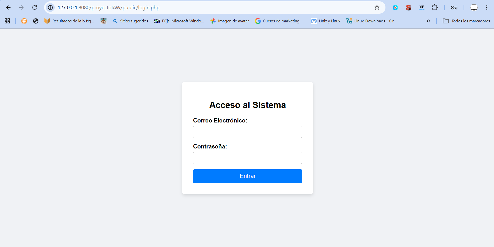
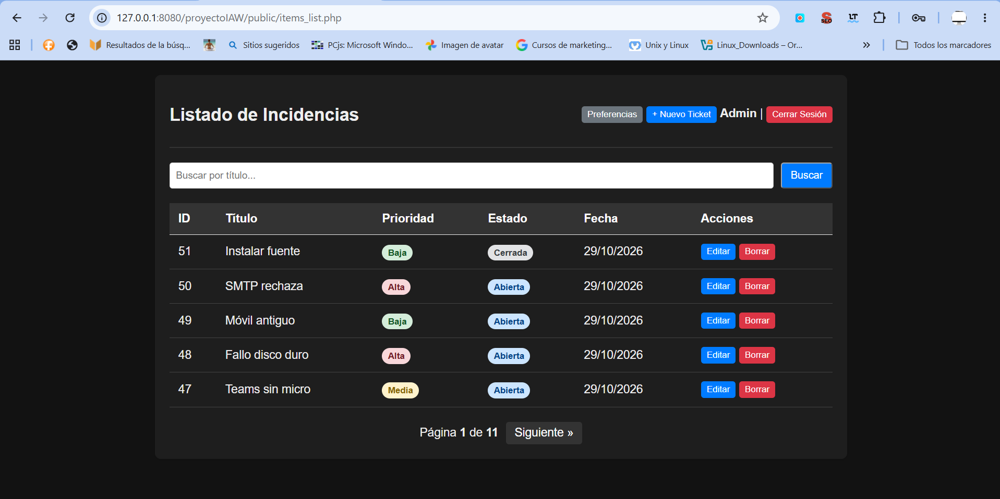
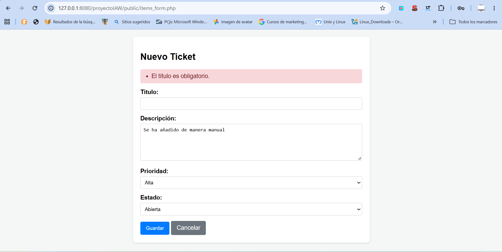
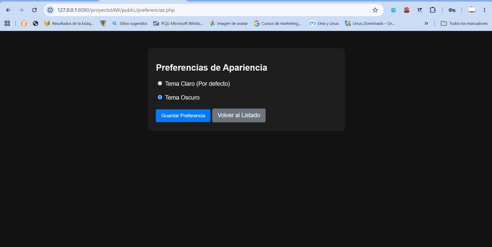
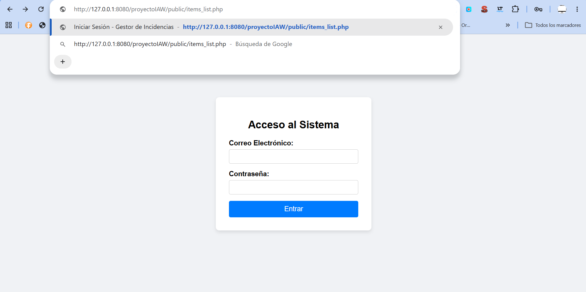
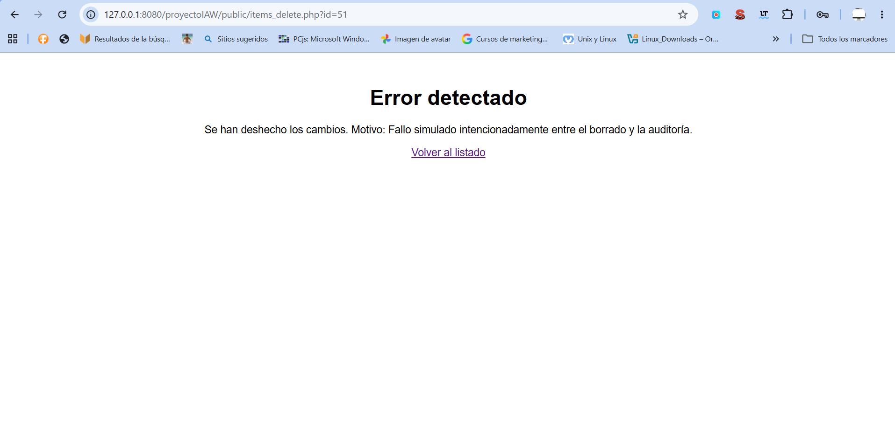

# Proyecto IAW - Gestor de Incidencias

Este proyecto consiste en una aplicación web desarrollada en PHP nativo (sin frameworks) para la gestión de tickets de soporte técnico (Helpdesk). Permite a los usuarios autenticados crear, listar, editar y eliminar incidencias de forma segura.

## Requisitos del sistema
Para ejecutar este proyecto es necesario contar con un entorno de servidor web (LAMP o WAMP) con los siguientes componentes:
- Apache (Servidor web)
- PHP 8.0 o superior (con el módulo `pdo_mysql` habilitado)
- MySQL o MariaDB (Base de datos)

## Pasos para la instalación
1. Clona este repositorio o descarga los archivos en tu equipo.
2. Mueve la carpeta `proyectoIAW` a tu directorio raíz de Apache (por ejemplo, `/var/www/html/` en Linux o `C:\wamp64\www\` en Windows).
3. Abre tu gestor de base de datos (phpMyAdmin) y crea una base de datos llamada `gestor_incidencias`.
4. Crea un usuario de MySQL llamado `iaw_user` con la contraseña `iaw_password` y otórgale todos los privilegios sobre la base de datos.
5. Importa los archivos SQL desde la terminal o desde phpMyAdmin en este orden:
   ```bash
   mysql -u iaw_user -p gestor_incidencias < sql/schema.sql
   mysql -u iaw_user -p gestor_incidencias < sql/seed.sql
(El archivo seed.sql contiene las tablas y 51 tickets de prueba).

Accede a la aplicación en tu navegador usando la ruta: http://localhost/proyectoIAW/public/login.php

Credenciales de prueba
Para probar la aplicación, puedes iniciar sesión con el siguiente usuario administrador:

Email: admin@test.com

Contraseña: 123456

Capturas de pantalla
A continuación se muestran las evidencias del funcionamiento de la aplicación:

1. Pantalla de Login:


2. Listado con paginación y búsqueda:


3. Formulario con validación de errores en servidor:


4. Aplicación de preferencia guardada en Cookie (Tema Oscuro):


5. Intento de acceso sin sesión (Redirección automática):


6. Prueba de Rollback en transacción de borrado:


Funcionalidades y seguridad implementadas
A lo largo del desarrollo se han aplicado los siguientes conceptos:

Sesiones y rutas protegidas: Todas las páginas internas verifican si el usuario ha iniciado sesión.

Protección CSRF: Uso de tokens únicos en los formularios comparados mediante hash_equals().

Prevención de XSS: Uso de una función de escape e() con htmlspecialchars() en todas las salidas.

Base de datos segura: Uso de PDO con consultas preparadas para evitar Inyección SQL.

Paginación y filtros: Listado dividido por páginas y buscador por título usando LIMIT y OFFSET.

Integridad de datos: Borrado mediante transacciones SQL (beginTransaction / rollBack) y registro en tabla de auditoría.

Preferencias de usuario: Uso de cookies para guardar el tema visual (claro/oscuro).
